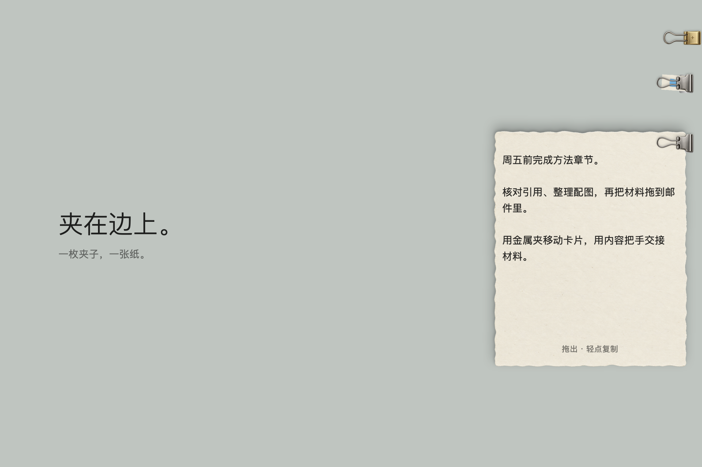

# 屏幕夹子 · ClampEverything

macOS 原生随手工作层。把文件、文件夹、图片、文字和链接夹在屏幕边缘；需要参照时拉出，需要交接时拖出内容。



## 下载与安装

- [下载 v1.7.16 DMG](https://github.com/Quartzsyr/ClampEverything/releases/download/v1.7.16/ClampEverything-1.7.16-arm64.dmg) · [详细更新说明](https://github.com/Quartzsyr/ClampEverything/releases/tag/v1.7.16) · [SHA-256](https://github.com/Quartzsyr/ClampEverything/releases/download/v1.7.16/ClampEverything-1.7.16-arm64.dmg.sha256)。安装包带纸质箭头、银夹背景与独立磁盘图标。
- 支持 **Apple Silicon（M 系列芯片）、macOS 14 及以上**。
- 打开 DMG，把 `ClampEverything.app` 拖入 `Applications`。更新前先从菜单栏退出旧版本。
- 应用常驻菜单栏，启动显示短暂的拟物纸签动画；菜单中打开设置。
- 当前是开发签名版本，**尚未经过 Apple 公证**。首次运行若被拦截，请确认下载来源后在系统设置的“隐私与安全性”中处理打开提示。

鼠标夹取需要辅助功能权限；图片区域夹取还需要屏幕录制权限。在“设置 → 鼠标夹取”中开启并授权。按住 Option，按下鼠标夹住内容，保持按键拖动，松开鼠标放置；Esc 或右键取消。跨应用识别取决于来源应用提供的辅助功能信息。

## 主要功能

- 夹住文件、文件夹、图片、文字、网页链接，支持材料组与工作场景。
- 十种拟物材质，统一夹点翻转，拖动惯性与松手回摆。
- 鼠标夹取提供目标名称、图片预览、读取状态和边缘吸附提示。
- 按住夹取键并停留约 0.3 秒，目标边缘显示柔和蓝紫轮廓光；继续停留后显示名称，移动时立即收起。常规瞄准只读取对象边界；大图继续长停留时，可在已授权后读取可见图片以识别主体。缺少边界时不画猜测框。
- 文件保留原位置；文字和截图保存本地副本，不自动记录剪贴板历史。
- 设置中的“能夹什么”展示支持类型与可拖动材质样品。

## 从源码构建

需要 macOS 与可用的 Swift / Apple 开发工具链。

```bash
bash scripts/test.sh
bash scripts/build-app.sh
bash scripts/build-dmg.sh
```

应用输出到 `build/ClampEverything.app`；DMG 与 SHA-256 文件位于 `build/`。构建脚本优先使用现有 Apple Development 签名，找不到时使用临时签名；未配置公证。脚本保留前一个应用包为 `build/ClampEverything.previous.app`。

## 上手

1. 从菜单栏选择“添加文件或文件夹”。也可在设置 → 使用习惯中开启默认关闭的黄铜色「＋」接收夹，再从 Finder 拖入内容。
2. 复制图片、文字或网页链接后，在菜单栏点击“夹住剪贴板”。不自动记录剪贴板历史。
3. 悬停边缘夹项临时查看；点击保持展开。抓住金属夹把卡片拖到屏幕内常驻，拖回左右边缘收起。
4. 从图片预览或“拖出内容”把手向目标应用拖放。只提供复制语义，夹项继续保留；单击内容把手可复制。
5. 右键夹子选择“编辑纸签”填写用途、分类和显示名称。文字副本在同一个编辑窗口中修改。
6. 菜单栏“夹项与恢复”按需列出内容及恢复项，不再打开管理主窗口。已有项目组继续可用。

文件夹卡片支持逐层导航、打开 Finder、拖出子项和独立的复制接收区。路径显示在浏览区域与复制结果中；重名自动保留两份，如 `报告 (2).pdf`。复制过程中“停止后续项”会完成当前项后停止，不回滚已完成文件。

收起按钮把常驻卡片送回边缘。点击卡片外部关闭靠边的保持展开状态。Esc 在屏幕夹子自己的窗口获取输入时可关闭靠边展开；参照面板不获取键盘焦点，因此在其他应用输入时使用鼠标关闭或全局显示/隐藏。

菜单栏提供全局显示/隐藏、撤销取消固定和设置。全局快捷键初始为空，点击设置中的录制区域配置组合键；注册冲突时保留旧配置。

## 数据与恢复

- 默认资料库：`~/Library/Application Support/ClampEverything/`。
- `library.json` 保存夹项、书签、标签、项目组和屏幕布局；`library.previous.json` 是上一份元数据快照；`Assets/` 保存剪贴板图片。
- 导入的文件和图片保持原位置，使用持久书签解析；原内容不可用时保留标签，并允许重新关联。
- 取消固定不删除原文件。内部图片和文字进入恢复区，保留 7 天，在启动与每小时检查时清理到期副本。
- 资料库损坏或来自较新格式时停止写入并提示路径，防止空状态覆盖原数据。恢复前先备份整个资料库，再检查上一份快照；快照不包含已经到期删除的图片。
- 云文件的下载与网站访问交由系统及对应应用处理。本应用未实现同步、分析统计或网络服务。

## 构建、测试与设计导出

需要 Apple Silicon Mac、macOS 14 或更高，以及 Swift Command Line Tools；已在本机 macOS 27、Swift 6.3.3、macOS 26.5 SDK 上验证。

```sh
bash scripts/build-app.sh release
bash scripts/test.sh
bash scripts/export-design.sh
```

脚本把编译缓存放在 `.build` 内，默认优先采用已安装的 macOS 26 SDK，也可通过 `SDKROOT` 指定 SDK。测试采用 Swift Testing，脚本为当前 Command Line Tools 配置框架与运行库路径。

设计导出从真正的 SwiftUI/AppKit 界面生成卡片状态 PNG（Liquid Glass 设置需从实际窗口截图），使用 `/private/tmp/ClampDemo-*` 隔离资料，不读取正式资料库。开发时运行可执行文件的 `--demo` 参数会创建一个独立示例资料库；`CLAMP_DATA_ROOT` 可指定开发资料库位置。

## 交付资料

- [视觉与交互规范](docs/DESIGN_SPEC.md)
- [实施与验收记录](docs/ACCEPTANCE.md)
- [架构与维护说明](docs/ARCHITECTURE.md)
- [项目夹状态图](docs/design/04-project.png)
- [复制结果状态图](docs/design/10-copy-results.png)

公开发行、Intel 构建、实机多屏热插拔与第三方应用拖放兼容矩阵仍需补充验证，具体边界见验收记录。

参考项目：[Tendedero](https://github.com/alejandrobujan/tendedero)。本实现独立编写源码与图标，参考其交互及窗口设计思想，未复制它的品牌、图标或源码文件。

## 拟物材质与设置（2026-10-13）

菜单栏夹子支持左键和右键菜单；“设置”按需打开独立玻璃面板，包含使用习惯、夹子与材质、资料与恢复。macOS 26 及以上使用系统 Liquid Glass，旧系统使用半透明材质。

黄铜色加号夹子是固定接收口；拖入内容生成银色内容夹。每张纸按夹项 ID 生成独立的细纤维、浅折痕和不规则边缘，重启后保留原样。照片不使用纸张背景，以原比例展示并加入薄厚度及边缘反射。

取消固定会释放旧窗口并阻止延迟悬停、缩略图回调重新显示它；手动收回后需重新进入夹子或点击才再次展开。恢复后可再次正常取消固定。

## 按住快捷键，用鼠标夹取

在菜单栏夹子 → 设置 → 鼠标夹取中启用。默认键位为 Option，也可录制单字母键、修饰键或组合键。按住后鼠标变成张开的金属夹；移到目标上按下，夹口收紧并带上内容提示；保持按键和鼠标按下，拖动到目标位置松手放置。左右边缘 42 点以内自动吸附，桌面中间保持悬浮。再次拖动已保存夹子的金属夹可调整位置；边缘高度会持久保存，相邻夹子自动避让。夹取后松开按键，再按可夹取下一项。松开、Esc 或右键退出，不将夹取点击传给原应用。

首次使用需要在系统设置中允许屏幕夹子的“辅助功能”，回到设置点击“重新检查”。图片区域截图另外需要“屏幕录制”权限；只夹文字、链接和文件引用不需要截图权限。权限由用户在 macOS 中授权，应用不会自动更改权限。

支持目标应用通过辅助功能暴露的文件 URL、网页链接、选中文字、文本元素与图片区域。文件保持原位；文字和链接存为夹项；图片原件不可读取时截取该图片在当前屏幕的可见区域。密码框、应用未暴露的自绘内容会提示无法夹取。不会模拟复制、读取整棵应用界面树或替换剪贴板。

单字母键启用后会被夹取功能占用；建议使用 Option 或修饰键组合。旧资料库升级后此功能默认关闭。截图预览见 `docs/design/14-hold-settings.png`。


## 生成素材与鼠标夹取修复

应用图标、银色夹子、黄铜加号夹子和棉纸底纹使用内置 imagegen 生成。原始透明 PNG 位于 `Sources/ClampEverything/Resources/Generated/`，完整提示词见 [IMAGEGEN_PROMPTS.md](docs/assets/IMAGEGEN_PROMPTS.md)。构建时压缩为实际显示尺寸，运行时缓存图片；纸张按夹项 ID 保持独立的翻转、色调、折痕和边缘变化。

鼠标夹取使用不接收鼠标事件的小型跟随面板，避免全屏透明窗口挡住目标。组合键的松开由事件监听器追踪，不再查询已被监听器吞掉的会话按键状态。文件、链接与文字优先于图像截图。

本地构建优先使用本机已有 Apple Development 签名，避免应用身份随每次构建变化。可用 `CLAMP_SIGNING_IDENTITY` 指定身份；没有开发身份时回退到临时签名。由临时签名切换到开发签名后，需要给当前版本授权一次，后续相同身份构建可保留授权。设置中的监听状态以当前进程的系统检测为准。

### 夹口与鼠标夹取修复（2026-10-13）

左右边缘的夹口都朝向纸张，金属夹压住纸边；黄铜接收夹也朝向屏幕内侧。鼠标夹取的夹口尖端与点击位置一致，移动时使用事件坐标跟随。按键释放由事件监听直接追踪，避免会话状态延迟导致夹子立即消失。

辅助功能授权后每两秒自动重试监听，返回应用时立即检查；安全输入结束或监听暂时停用后自动恢复。设置明确显示未启动原因。临时签名更新后如仍提示权限不足，请在系统设置 → 隐私与安全性 → 辅助功能中重新开启屏幕夹子，再使用原来的夹取组合键。

本次 46 项测试通过，包括 ⌥J 夹取后重新按下、多屏坐标和夹口点击位置。左右附着效果图见 `docs/design/16-attachment-left.png`、`docs/design/16-attachment-right.png`。当前机器未授予修复版辅助功能权限，跨应用夹取需要授权后继续实机验证。

### 柔软纸张与照片（1.1）

右侧夹子的圆弧朝屏幕外，左侧镜像。后夹片位于纸张后方，前夹片压住纸面；薄接触阴影与轻微反光呈现厚度。纸张改用平静的薄棉纸底纹，不再叠加预制的大卷角。

纸张和照片都支持抓住金属夹移动、鼠标经过自由边时轻摆、拖动远离夹子的底角卷起；松手后展开并回弹。照片的像素与边缘一起弯曲，保留原始比例与原文件，折起时露出浅色背面。纸上文字保持可读，链接、文件导航、复制和拖出继续使用原来的控件。收回、折角与调整大小的区域相互避让。系统“减少动态效果”关闭自动轻摆及弹簧动画，仍可手动折角。

素材：`Sources/ClampEverything/Resources/Generated/paper-calm-v2.png`。内置 imagegen 生成，提示词见 `docs/assets/IMAGEGEN_PROMPTS.md`。视觉对照见 `docs/design/17-soft-sheet.png`。新增固定夹角、折叠范围、轻摆边界与照片面板比例测试，50 项测试通过。实际启动验证了黄铜夹子单击添加；两次开发签名构建的 designated requirement 一致。跨应用鼠标夹取仍待当前签名版本完成系统授权后实机验证。

### 从屏幕外拉入（1.2）

左右屏幕边缘的夹子互为水平镜像，右侧圆弧朝外。悬停或点击内容夹时，纸张和照片从相应屏幕边界外滑入夹子下面；收回时沿原路滑出，再缩为边缘入口。重复收放与删除会取消旧动画，减少动态效果时立即切换。拖动使用速度惯性和更明显的受夹角摆动，松手后回落；纸张和照片增加接触阴影与柔软的投影。

菜单栏、黄铜夹子右键菜单和设置提供“夹子使用指引”。指引只有实际夹子、周围的短文字和细引线，背景透明，不接收鼠标事件，不阻挡夹子。空资料库启动时自动显示；操作后或 14 秒后收起。52 项测试通过，包含左右滑入与快速重开回归；预览为 `docs/design/18-clip-guide.png` 和 `docs/design/19-edge-reveal.png`。

### 夹子跟随内容（1.2.1）

夹子的圆弧尾部统一朝左。展开和收回时，前夹片、后夹片、纸张或照片作为整体一起滑入、滑出，夹口与内容之间保持原来的相对位置。右侧夹子稍向纸内靠拢，夹口继续压住纸边。指引中的夹子方向同步更新。

### 夹点翻出（1.3.0）

点击或悬停展开时，纸张和照片绕夹口翻出，夹子与受夹的纸角一起向屏幕内移动 10 点。左右边缘的翻转方向相反，夹子尾部仍统一朝左。自由边轻轻回摆后落稳；收起沿同一夹点反向折回。前后夹片始终夹住内容，原有阴影、拖动轻摆和折角继续保留。

翻转期间临时增加透明窗口下方的空间，纸张保持原尺寸，避免自由角被窗口截断；落稳后恢复窗口。快速重复收放、删除和开始拖动会取消旧动画；系统减少动态效果时直接切换。55 项测试通过，包含夹点贴合、左右翻转、自由角动画空间与窗口恢复。关键帧预览：`docs/design/19-hinge-reveal.png`。

### 直接夹取与可调吸附（2026-10-13）

鼠标按下时异步识别目标，避免拖到空白处后丢失来源；拖拽事件不会传给原应用。夹口保留开合弹簧、文件图标或文字提示、靠边变色及松手收紧反馈，遵循系统减少动态效果设置。可访问的文件、文字、链接保留原始类型；图像、按钮、Dock 图标、菜单项与单元格无法提供原件时，使用屏幕录制权限保存其可见区域。应用不公开辅助功能信息的区域仍可能无法识别；不会读取密码框。

验证：新增跨屏边缘判定、边缘高度往返、拥挤避让、放置持久化与旧数据兼容测试。跨应用夹取仍需对当前应用授权辅助功能；图标截图另需屏幕录制权限。

### 权限诊断与稳定安装

运行版本使用 `~/Applications/ClampEverything.app`，避免文稿同步目录为应用重新附加 FinderInfo 导致严格签名校验失败。保留相同开发签名；系统设置的开关状态不能替代应用自身的 `AXIsProcessTrusted()` 与事件监听启动结果。

应用支持 `--permission-report /private/tmp/clamp-permissions.json`，记录当前应用路径、进程、辅助功能、事件监听、屏幕录制和安全输入状态；支持 `--request-accessibility` 发起 macOS 原生授权请求。授权由系统管理，应用不会写入 TCC 数据库或绕过系统确认。

### 按内容区分材质与自定义设置（2026-10-13）

文件夹和项目组使用带标签页、双层封面、细纹和压纹的文件夹卡片，展开与收起都保持该形态；文件使用硬质灰白卡片，链接使用青绿色卡片，照片继续直接显示图片。自然纸、暖白纸与横线便笺用于文字内容。文件夹和硬质卡片没有纸张卷角，纸张与照片保留轻卷和回弹。

设置 → 夹子与材质可调整三种文件夹配色、三种文字纸张、0–150% 卡片动效强度；设置 → 使用习惯可调整自动吸附、16–96 点吸附距离、默认停靠侧、悬停展开和 0.1–1.2 秒等待时间。设置即时生效并持久保存；各页分别恢复默认值，保留已授权的鼠标夹取开关与快捷键。

界面验证图：`docs/design/20-content-housings.png`、`21-custom-materials.png`、`22-custom-behavior.png`、`23-folder-palettes.png`。可使用 `--export-customization <目录>` 在独立演示资料库导出这些原生界面预览。

### 临时工作台（1.5.0）

按四项优先级完成：

1. **收起可辨认**：边缘标签显示名称、类型与材料组数量；缩略图保留文件夹、文字、照片各自的形态。设置 → 使用习惯可关闭名称标签，恢复窄夹子。
2. **拖出直接使用**：拖动边缘缩略图、展开卡片的拖出条或材料组的成员图标，将原生文件 URL、文字、图片或链接交给其他应用。预览显示名称并保持图像比例，原内容保留。
3. **文件夹与分组**：文件夹和材料组沿底部折线掀盖；拖动金属夹到另一张卡片，停留约 0.45 秒出现“松手夹成一组”后松手合并。也可将内容拖到目标卡片上方中央并停留。材料组的 ⋯ 菜单可排序、保留归属拉出常驻或从组中抽出。拖出缩略图到外部应用只交接副本；文件夹“复制到此文件夹”区域仍执行原有复制。
4. **工作场景**：菜单栏 → 工作场景 → 管理场景，或设置 → 工作场景。保存当前材料后勾选成员；可改名、切换、删除场景。新夹入内容自动加入当前场景，删除场景不删除材料。场景仅控制显示范围，共享原夹项和位置，未保存独立布局快照。

资料库窗口已接回“夹项与恢复”入口，支持搜索、选择多项、建立材料组和恢复夹项。吸附增加落点预览与短距离落位动画，遵循减少动态效果设置。

验证：73 项测试通过；场景往返、旧库兼容、跨场景延迟悬停、分组抽取、拖放数据、标签宽度和封面折线均有覆盖。原生界面预览见 `docs/design/24-workbench.png`、`25-folder-opening.png`。外部应用是否接受特定拖放格式仍由接收应用决定。

### 简洁收起与平稳展开（1.5.1）

收起固定为 64 点宽，只显示夹子与一小角内容；移除边缘名称/类型标签和对应设置，旧保存值被忽略。文件夹与材料组取消掀盖投影，使用 0.18 秒淡入、最多 6 点水平和 3 点垂直位移，关闭为 0.12 秒淡出；纸张与照片的原有动效保留。

鼠标夹取期间临时激活夹子应用，因为 Core Graphics 隐藏指针通常要求调用方位于前台。设置和编辑窗口临时放到后台，隐藏系统指针成功后才显示鼠标夹子；松开、取消、失去前台、休眠或关闭监听均平衡恢复指针，并在适用时恢复原应用。隐藏失败时取消夹取，避免同时显示夹子和箭头。

验证：75 项测试通过，包括旧标签配置兼容、短展开/关闭、隐藏计数配对与失败重试。预览更新为 `docs/design/24-workbench.png` 和 `25-folder-reveal.png`；旧掀盖预览仅供历史对照。跨应用隐藏指针仍需在当前应用获得辅助功能授权后实机验证。

### 材料物理与袋口抽取（1.6.0）

鼠标夹子使用独立机械绘制：圆弧钢丝始终在左，右侧夹口中心对应点击热点，开合不镜像、不改变热点。夹住薄纸、照片和厚材料时保留对应开度；系统箭头仍按前台隐藏逻辑恢复。

文件夹与材料组保留固定外壳和夹点，袋口有限撑开，内页从封面后方抽出 12 点，关闭时回退。材料组根据成员数量显示有限层叠，并在成员抽出后重排。取消整个文件夹的掀盖变形。

文字使用棉纸便笺，照片使用相纸、薄背面与随受力移动的反光，链接使用带缺口的书签卡，普通文件使用带原图标和名称的硬质文件签。PDF/文档增加装订边与页层；音频使用带螺钉的录音卡；视频使用胶片孔；压缩包使用封口与拉链纹理。这些文件卡片仍使用原文件打开、预览和拖出，不额外实现媒体播放器。分类与物理参数为显示层信息，原文件不改变。

不同材质有不同夹口开度、柔度、惯性和回弹；柔性与硬质运动都固定在实际夹点，纸角与照片角拉动幅度不同。设置 → 夹子与材质新增可选触控板轻触反馈，默认关闭，需要支持触感的硬件。系统减少动态效果优先生效。

验证：材质分类、厚度/惯性排序、夹点固定、袋口运动边界和既有鼠标恢复/场景交互均有测试覆盖。原生渲染预览：`docs/design/26-physical-materials.png`、`27-folder-pocket.png`、`28-mouse-clip.png`。

### ImageGen 左向鼠标夹子（1.6.1）

以用户截图中的拉丝金属夹为参考，由 ImageGen 生成左向张开、半夹紧、闭合三姿态透明图集 `cursor-clip-left-atlas.png`。鼠标夹子恢复同款金属外观，夹口朝左、钢丝圆弧朝右；点击热点更新为跟随面板左侧的 `(5, 23)`。三姿态在运行时按透明轮廓对齐并使用统一物理比例，随开度切换清晰的三关键帧，避免透明混合重影；其他卡片夹子保持原有方向。

验证：81 项测试通过，包括三姿态透明资源、开合关键帧和左侧热点；接入后的原生预览见 `docs/design/28-mouse-clip.png`。

### 统一翻转与启动纸签

文件夹、材料组、文件、链接、便笺和照片统一绕夹点翻出，收起沿同一路径反向翻回。材料组条目的出入也使用翻转，移除原先文件夹及条目的滑动淡入；所有材料都预留翻转所需的窗口空间，落稳后恢复。

正常启动时，屏幕右边的金属夹夹住品牌纸签，纸签翻出、停稳，再翻回收起，约 1.9 秒自动结束。演示窗口不接收鼠标、不抢焦点，结束或退出时清理；空资料库指引随后显示。系统“减少动态效果”、动效强度为零、设计导出和直接打开设置时跳过启动演示。84 项测试通过，覆盖所有材料翻转与启动窗口的完成、取消、释放。

### 支持类型与拖动材质

设置新增“能夹什么”页面，列出全部支持类型、文件扩展名、拟物形态和拖动反馈，并提供可拖动样品。文字对应便笺，图片对应相纸，链接对应书签，文件夹与材料组对应资料袋；文件进一步区分为装订文稿、录音卡带、胶片卡、拉链收纳袋和通用硬质卡片。

整体拖动惯性不再被材质柔软度削弱。所有十种材质在横向、纵向拖动时都绕固定夹点倾斜，松手弹回；软材质叠加轻微形变，文件夹及材料组增加袋口与内页错动。动效强度与系统减少动态效果仍然优先生效。85 项测试通过，新增全材质、双方向拖动位移与夹点固定验证。

### 鼠标夹取：读取预览与可靠取消

按住夹取键时显示鼠标旁的操作提示；按下后显示读取状态、目标名称与图片缩略预览，拖到边缘显示吸附提示。图片区域在拾取阶段读取并保存，放下时使用同一张图片，不再重新截取变化后的来源窗口。文件身份优先，明确选中的文字优先于其父级网页链接；不把未知容器扩大为整窗截图。

读取与放置等待期间也支持 Esc / 右键取消。取消会传播给后台读取任务，并通过代次隔离旧任务收尾，防止影响下一次夹取。设置补充四步操作说明。93 项测试通过，覆盖选中文本优先级、原文件身份、安全输入拒绝、截图来源冻结、取消后不交付图片，以及原有窗口与存储功能。跨应用可读内容仍取决于来源应用提供的辅助功能信息。

### 夹取前的对象轮廓光

目标边缘采用透明中心、细亮边与柔和投影；支持文本选区边界与多显示器坐标转换。滚动、移动、开始夹取、取消和退出都会清除高亮。后台读取按代次隔离，避免旧目标迟到；静止时低频复核边界。系统减少动态效果时保留静态轮廓、取消渐入。99 项测试通过，包含边界裁切、选区优先、延迟提示与取消隔离。

### 拖拽跟手与夹取交接（1.6.2）

窗口位置按每个鼠标事件直接更新，材质速度反馈最多 60 Hz，按真实时间计算，避免不同鼠标采样率带来不同手感。移动中使用轻量整体摆动，停手或松手后才使用弹簧回落；纸张与照片移动时暂停纹理网格弯曲，文件及材料组内容避免随每帧受力重新计算。边缘放下沿夹点翻回，快速再次拿起会取消旧收回任务。

鼠标夹取在读取成功后按材质厚度夹紧，携带材料轻摆。文件类型信息在后台读取；松手时仍在读取则恢复普通指针并保留进度提示。夹项与最终落点一起提交，减少默认边缘的瞬时闪现。105 项测试通过，新增输入频率一致性、逐事件窗口位置、停手回落、批量落位与快速重拿回归。该轮依据代码与自动化测试优化，未做界面手动性能测量。

### 不同内容的瞄准光效（1.6.3）

文字用暖白逐行细框，图片用冷蓝贴边光，网页链接用薄荷色底边光，文件夹用琥珀圆角边光，普通文件用淡紫四角光。图片文件采用图片光效。读取来源应用提供的原生视觉行范围，支持换行后的文字与局部选区；超过 24 行或来源不支持逐行范围时退回选区或对象边界。瞄准过程中不截图、不推测像素轮廓。

在同一目标内移动时降至低亮度，停稳并重新确认目标后亮起；移出目标、滚动或取消立即清除，名称提示只在停留后出现。光效中心透明，不拦截鼠标事件，减少动态效果时保留静态提示。109 项测试通过，包含五类风格、多行局部坐标、类型切换与移动降亮。

### 明显高亮与图形化安装包（1.6.4）

文字瞄准采用逐行金黄色半透明底纹（停稳约 46% 填充），同时保留边线；移动时降亮。其他内容增加边线厚度与光晕强度。DMG 新增固定安装布局、拖向 Applications 的箭头、安装说明与独立磁盘图标；图标由内置 imagegen 生成，原图与提示词位于 `docs/assets/installer/`。

DMG 打包通过 Python 的 `ds-store` / `mac_alias` 写入 Finder 布局，不打开或控制 Finder。首次打包会把固定版本的构建依赖安装到 `build/dmg-tools/`。109 项测试通过，最终镜像检查包含背景别名、图标位置、卷图标与应用签名。

### 夹子随材料整体翻转（1.6.5）

翻转层改为同时包含前夹片、后夹片、材料与拖动把手，围绕同一夹点转动。左右边缘各自调整夹子的初始朝向，收起后尾部统一向下；夹口位置在局部旋转和收起缩放时保持固定。展开与收起对齐夹点高度，拖动拿起也沿用该位置；保持既有翻转角度与弹簧节奏，启动纸签同步使用完整夹子翻转。此版本先实现整体旋转，尚未增加钉子挂点。

114 项自动化测试通过，包含左右尾部朝下、夹口固定、收起与翻转首帧的金属轮廓连续、紧凑入口边界与窗口位置衔接。


### 原形银夹与钉子悬挂（1.6.6）

参照原银色夹子的宽夹体、水滴形线环与铰接耳生成三种开合姿态，尾环在铰接处向上掰起。卡片与前后夹片共同绕尾环内侧翻转，钉子留在原位；拖起夹子时隐藏钉子。收起缩放同步校正材料位置，夹口始终贴住材料；照片布局为尾环预留空间，启动纸签使用同一悬挂方式。

素材与完整生成提示词见 [HANGING_CLIP_PROMPT.md](docs/assets/HANGING_CLIP_PROMPT.md)。

113 项自动化测试通过，覆盖悬挂支点固定、收放夹口贴合、两侧紧凑入口连续、展开与拖动拿起的位置衔接，以及原有窗口和捕获功能。通过 SwiftUI 离屏渲染核对关键帧，预览见 [银夹悬挂翻转](docs/design/20-hanging-silver-clip.png)。


### 统一小尺寸与材质夹点修复（1.6.7）

侧边收起、翻出、悬挂和拖动统一使用约 20×26 点的银夹，取消随展开进度放大；钉子同步缩小。两侧夹口向材料内侧对齐，避开圆角与边缘外部。文件夹和材料组按标签下方的实体肩边计算高度，普通纸张、照片、文件和书签保持浅夹入，修复文件夹上方悬空的问题。缩略材料也对齐同一夹口。

115 项自动化测试通过，新增全程尺寸恒定及六类材质边缘接触检查，包含短窗口和文件夹实际轮廓。离屏材质预览见 [统一尺寸与夹口贴合](docs/design/21-clip-attachment.png)。


### 大缩略图、拖动展开抑制与内容预览（1.6.8）

收起材料从约 18×14 点扩大到 30×23 点，侧边入口增高并增加间距，夹子维持小尺寸。图片和文件优先显示系统生成的缩略内容，文件夹与材料组的轮廓也更易辨认。悬停展开同时检查按住鼠标、其他材料拖动和鼠标夹取状态；拖动经过夹项后，需离开再进入或主动单击才展开，延迟回调也重复检查。

展开后的 PDF 支持逐页阅读和页码；Word / DOCX 及其他办公文档使用系统 Quick Look 内嵌预览，并提供独立快速预览与打开原文件。代码与文本支持行号、语法着色、横向滚动、Unicode 和选中复制，大文件显示前 400 行或 128 KB。网页展示标题、地址和可用的封面，失败仍可打开原链接；元数据缓存最多 12 项、10 分钟，收起取消未完成请求。网页预览在展开链接时联网获取。

127 项自动化测试通过，覆盖实际 PDF 翻页、DOCX 生成及 Quick Look 释放、代码编码与截断、网页缓存失效、拖动经过夹项、收起夹项沿边移动不展开和扩大缩略图的两侧边界。系统预览能力参考 [Quick Look](https://developer.apple.com/documentation/quicklookui/qlpreviewview/previewitem)，网页元数据使用 [Link Presentation](https://developer.apple.com/documentation/LinkPresentation/LPMetadataProvider)。

从侧边拿起收起夹项时保持缩略形态；沿边放下继续收起，离开边缘放下才展开，并对齐悬挂位置。


### 简洁文件夹与直接复制（1.6.9）

文件夹保留标签和单层口袋轮廓，隐藏重复标题、路径、底部复制条和每行的冗余操作。图标与名称整块用于单击复制或拖出复制；子文件夹仅保留进入箭头，刷新、Finder、隐藏文件开关收入标题区菜单。文件列表延迟创建行，拖入时才显示接收提示，复制进度压缩为一行。材料组内容也使用同样的复制区域。

文件、代码、网页、文字、文件夹及目录条目都在主要内容上执行单击复制、拖出复制，复制的是原文件 / 原链接 / 原文字。复制成功出现短暂勾选反馈；拖动结束的松手不会额外复制。合并接收区缩到金属夹附近，避免遮住内容。移除底部小字操作入口。

PDF / DOCX 的卡内预览统一为 160 点高的图片缩略，系统缩略失败时，PDF 用 PDFKit 渲染第一页，DOCX 使用原生文档读取器生成简化首页。完整阅读通过独立“预览”打开。

网页改用 WebKit 渲染链接页面首屏，按桌面视口缩放后生成图片；不再依赖网站封面元数据。采用临时浏览会话、不自动播放、不打开弹窗，首屏缓存最多 8 项、10 分钟。网页无法访问时保留复制与打开入口；需要登录的页面显示独立会话实际可访问的内容。实现参考 [WKWebView 快照](https://github.com/WebKit/WebKit/blob/main/Source/WebKit/UIProcess/API/Cocoa/WKWebView.h) 与 [临时网页数据存储](https://developer.apple.com/documentation/webkit/wkwebsitedatastore)。

130 项自动化测试通过，包含原内容点击 / 拖出、文件 URL 接收、PDF 和 DOCX 有界缩略、无封面元数据网页的实际渲染与像素验证。文件夹离屏预览：[精简文件夹](docs/design/22-clean-folder.png)。


### 极简实物呈现（1.7.0）

文件夹与材料组延续文件袋，其余内容取消公共卡片底板、标题栏、格式栏、常驻按钮、备注卡和外层圆角框。便笺和代码直接写在独立纸页上；PDF / DOCX 直接展示文稿首页，网页直接展示首屏；音频为卡带，视频为有真实齿孔的胶片，压缩包为牛皮纸收纳袋。文件名、打开、完整预览、备注和来源操作收在悬停提示及右键菜单。

窗口按实物内容自适应：短便笺收短，代码纸页控制阅读高度，文稿和网页保留 160 点高的预览上限，照片保持原有比例与交互。所有实物维持单击复制和拖出复制原内容；缩略状态、设置中的材质样品同步统一。纹理由内置 ImageGen 生成的轻薄白纸提供，素材与完整提示词见 [MINIMAL_PAPER_PROMPT.md](docs/assets/MINIMAL_PAPER_PROMPT.md)。

夹子和材料继续一起绕钉子翻转；接触阴影改为贴合实际夹口。异步缩略图只在停止拖动、完成翻转后调整窗口尺寸，悬挂位置保持不变。

136 项自动化测试通过，覆盖全部内容的实物类型、自适应尺寸、短便笺、预览上限、胶片齿孔、异步缩略尺寸与夹取放回归。实际视图离屏预览：[极简实物](docs/design/23-minimal-objects.png)。


### 内容独立尺寸与安装指引（1.7.1）

设置 →「内容大小」提供 PDF、Word / 其他文稿、网页、照片、文字、代码、其他文件、文件夹、收纳夹、音频、视频、压缩包共 12 类独立尺寸调整（65%–180%），即时生效并本地保存，可恢复全部默认值。PDF / 文稿默认预览高度由 160 点增至 256 点，网页增至 208 点；内容保留比例，尺寸受屏幕可用空间约束，金属夹和收起缩略图保持统一。

DMG 使用内置 imagegen 生成的纸质箭头与银色夹子背景，背景引用在挂载卷上生成，补齐 Finder 图标视图和滚动位置配置。构建后重新挂载最终压缩包到不同路径，以 macOS 原生别名解析检查实际背景文件、原生图标位置和应用签名。设计素材及提示词见 [INSTALLER_PAPER_ARROW_PROMPT.md](docs/assets/INSTALLER_PAPER_ARROW_PROMPT.md)；配置参考 [dmgbuild 实现](https://github.com/dmgbuild/dmgbuild/blob/main/src/dmgbuild/core.py)。


### 动态新手引导（1.7.2）

从菜单「夹子使用指引」或设置「查看夹子指引」打开动态演示，逐个展示文字便笺、照片、PDF、Word、网页首屏、代码、文件夹、收纳夹、音频、视频、压缩包和其他文件共 12 类示例。每例依次演示瞄准、夹紧、靠边悬挂、翻转展开、点击复制、拖出复制；夹子与内容一起翻转，复制后保留原夹项。

支持自动播放、暂停 / 继续、上一类 / 下一类、点击类型跳转、重播本例、结束后重看；空格控制播放，Esc 结束。系统减少动态效果或关闭动效时，保留逐步示例与文字说明，关闭几何运动。引导可随时关闭，不再限时 14 秒消失；关闭和重新打开会取消旧播放任务，示例不写入用户资料库或剪贴板。

PDF 与 Word 使用原生首页渲染，网页使用无外部资源的离线 HTML 首屏，代码使用同一语法着色器，材料使用应用的纸张、相纸、文件袋、卡带、胶片和收纳袋组件。示例总览见 [全部类型](docs/design/27-guide-all-types.png)，引导布局见 [动态引导](docs/design/26-animated-guide.png)。


### 翻页与实时网页阅读（1.7.3）

PDF 在夹住的缩略纸页内按原页码阅读，滚轮、触控板或悬停后出现的两侧页角按钮切换上一页 / 下一页。Word（DOCX / DOC）、RTF / RTFD、ODT 通过原生文本排版器按内容分页；复杂文稿的精确版式以系统预览为准，其他仅有系统缩略图的格式保留「系统预览」入口。文稿翻页时，旧页沿夹边弯曲、翻起，并带有侧面明暗与投影；一次触控板手势最多翻一页，惯性不连翻。只保留最近三张渲染页，PDF 不预先栅格化整个文件。

网页改为保留实时 WebKit 页面，滚轮可以浏览正文及鼠标下的内嵌滚动区域，滚动时纸页自由边轻弯、停止后回弹。网页仍保持临时会话、不自动播放和不打开弹窗。重新加载会清理旧首屏缓存，避免重试继续拿到旧截图。

文稿页码和网页正文滚动位置在本次应用运行内按夹项保留，收起再展开可以继续阅读。内容主体仍支持单击复制和拖出原内容；滚动不会触发误复制，文字和代码的滚轮转交给原生阅读区域。系统减少动态效果或关闭动效时，保留翻页和滚动，关闭纸页运动。参考 [NSLayoutManager](https://developer.apple.com/documentation/appkit/nslayoutmanager) 与 [WKWebView](https://developer.apple.com/documentation/webkit/wkwebview)。


### 网页自动等比适配（1.7.4）

网页预览根据页面实际宽度自动等比缩放，固定宽度的网站、宽图片和较宽的内容区可以完整显示左右边缘；不再仅按固定 1024 像素计算缩放。调整预览尺寸时自动重新适配，页面动态内容、图片及字体加载后继续检测宽度变化。长网页保持上下滚动，不拉伸或压扁内容。

保留实时浏览、内嵌区域滚动、阅读位置、单击复制和拖出复制；非常宽的网页使用更小的缩放时，鼠标定位及滚动距离也使用实际缩放比换算。原生 WebKit 测试覆盖 1600 / 3200 像素宽页面、192×320 / 320×200 / 540×180 预览区域、左右边缘的快照像素、动态宽内容及低缩放下的滚动距离。实现使用 [WKWebView.pageZoom](https://developer.apple.com/documentation/webkit/wkwebview/pagezoom)。


### 左侧装订翻页与轻磨损纸页（1.7.5）

PDF / Word 等文稿翻页改为整条左边固定的装订轴，下一页揭起当前页，上一页沿同一装订线放回前页。纸页图像、弯曲、轮廓与卷角使用同一透视投影，翻页不会围绕右上角斜转；新页从自由边逐渐露出，夹子保持悬挂在纸叠上。

文字、代码、PDF / 文稿、网页纸页与纸质附件加入确定性轻磨损边缘、细纤维描边和小卷角；磨损不随每一帧随机变化，装订边及夹口接触区保持平直，正文中央保留完整。纸角可轻拉后回落，拖动时自由角轻微起伏；关闭动效及减少动态效果时保留静态材质。照片、文件袋和媒体外壳保持各自材质。

效果：[左侧装订线正反翻页](docs/design/29-left-binding-turn.png) · [纸页材质](docs/design/30-worn-manuscripts.png)。


### 网页与代码的完整宽度适配（1.7.6）

网页保持桌面宽度和原始 CSS 字号排版，再将整个原生视图等比缩小。解决 GitHub 等页面在 `pageZoom` 缩小后被最小逻辑字号重新撑大、导航越界、正文挤成窄列的问题；完整显示左右宽度，长页面继续滚动，尺寸调整、动态宽内容和内嵌滚动继续适配。已用真实 GitHub 仓库页面及 SwiftUI 宿主渲染验证。

代码与纯文本文件按纸页宽度调整字号，超过可读字号下限的长行自动换行，避免右侧内容被裁掉。行号和正文共享 TextKit 布局，续行不增加原始行号；保留缩进、Unicode、语法着色、点击复制与拖出原文件。设置中的网页和代码大小仍可分别调整。

效果：[网页完整宽度](docs/design/31-web-width-fit.png) · [代码长行适配](docs/design/32-code-width-fit.png)。


### 朝外掀起的文稿翻页（1.7.7）

PDF / Word 等文稿沿左侧装订线朝观看者翻起，自由边靠近并放大，上一页反向落回。纸面、磨损轮廓和卷角使用同一外翻投影；翻页时临时增加透明绘制空间，保持夹子和纸叠位置固定，结束后恢复，避免掀起的边缘被原矩形裁掉。

效果：[向外翻页关键帧](docs/design/33-outward-page-turn.png)。


### 文稿单击复制修复（1.7.8）

文稿外翻时窗口会临时扩展并收回，点击与拖动距离改用屏幕坐标，避免把窗口位置变化当成鼠标移动，修复 PDF / DOCX 翻页过程中单击复制可能失效的问题。触控板零位移事件不再吞掉单击；实际滚动仍取消点击，保留翻页、拖出原文件及原文件复制。


### 简洁文件夹与完整目录浏览（1.7.9）

文件夹只保留浅色内页、底部薄口袋边、目录名与项目数；移除重复大图标、分隔线和多层纸叠。使用原生可复用列表完整显示当前目录，文件行上可直接滚动，支持触控板惯性与大量项目；子文件夹用右侧箭头进入，支持返回、回到根目录及显示隐藏文件。

外部新增、删除、重命名自动刷新，刷新时保留可见位置。保留单击复制、拖出原文件、右键操作及拖入复制。验证覆盖 1,100 多个目录项和 1,500 行列表，确保末项可达，复用行不会把原点击复制成其他文件。

效果：[简化文件夹](docs/design/34-minimal-folder-list.png)。


### 明确的页内复制反馈（1.7.10）

点击复制后在内容中央短暂显示“已复制”，原文件不可用或剪贴板写入失败时显示“未能复制”。提示避开夹子和翻页控件，文件行使用紧凑版本；反馈依据实际写入结果，保留复制原文件、拖出和滚动操作。

效果：[页内复制提示](docs/design/35-copy-feedback.png)。


### 自然的鼠标夹取过渡（1.7.11）

鼠标夹住时，内容从原位置轻微受压、抬起，再收拢到夹口；夹口随内容到达而闭合，小物件轻轻回摆后进入随手拖动状态。文字按可读行区域提起局部纸片，照片保持图片比例，文件与文件夹使用原生图标，再过渡成各自的纸张、文件袋或媒体材质；软纸弯曲更明显，硬质内容保持挺度，厚材料动作略沉。

收拢终点实时跟随鼠标，夹口接触点与携带状态共用同一几何位置，避免物件悬空、突然出现或交接跳动。快速松手会完成正在进行的夹取再放置，不重新读取原对象；Esc、右键、退出夹取和会话切换会取消未完成的动画。系统减少动态效果或关闭动效时直接显示夹住状态。过渡展示内容的可视副本，不移动来源应用中的对象。

效果：[鼠标夹取关键帧](docs/design/36-cursor-pickup.png)。


### 轻量夹取提示与可选黄铜夹（1.7.12）

夹取完成提示改为放置点附近的小号勾选文字，移除大夹子图标和宽提示框，短暂停留后淡出；普通说明与错误使用不同符号，错误停留更久以便阅读。开始下一次夹取时立即收起旧提示，旧提示的淡出不会隐藏新提示。关闭动效时保留轻量透明度反馈。

“设置 → 使用习惯 → 显示黄铜接收夹”可控制屏幕右上角的添加入口，默认关闭，旧配置缺少此项时也默认关闭。修改后立即作用于所有屏幕并自动保存，恢复交互默认值会重新关闭；使用指引不会强制显示它。关闭后仍可从菜单栏添加文件、夹住剪贴板或使用鼠标夹取，已有夹项保持显示。


### 提示排版、文稿复制与薄纸文件袋（1.7.13）

夹取提示改为原生文字视图，测量和绘制使用同一字体；“已夹住”等短提示固定单行，说明与错误按可用宽度换行，修复中文最后一个字被挤到下一行的问题。保留小尺寸、深浅色适配和淡入淡出。

修复 PDF / DOCX 翻页后残留的触控板惯性事件取消新点击的问题。按下纸页会停止上一轮惯性并暂时稳定悬停形变，释放时复制；新发起的滚动仍取消点击并正常阅读。文稿测试直接使用完整预览的实际复制回调，验证中文及带空格文件名、原文件 URL 的系统读取、复制反馈和翻页窗口扩展 / 收回，不再替换复制回调。

文件夹改为更窄的哑光边框和顶部索引耳、暖白内页、浅底部折边，减弱强渐变与厚边框；文件列表使用更小的图标、紧凑行距和较淡的浏览箭头，保留完整目录、子目录进入、滚动、单击复制与拖出功能。

效果：[提示与文件夹](docs/design/37-feedback-folder.png)。


### 大图长停留主体夹取（1.7.14）

按住鼠标夹取键，在打开的大图或网页中的大图上短暂停留后点击，仍按原有方式夹整图。普通瞄准轮廓出现后，继续在同一主体上停留约 1.2 秒，应用会在本机分析可见图片；等待薄荷色主体轮廓亮起，再点击，即可单独夹住该主体。轮廓贴合主体和孔洞，并带轻填色；移动时降低亮度，停稳后恢复。移到另一个主体上继续停留，可以重新选择。

仅明确的大尺寸图片区域参与识别，排除文件列表、Dock、按钮中的图标和标记为缩略图的对象；较小图片保留原有整图 / 文件夹取。来源应用须提供可读图片区域。背景反差与 Sobel 边缘用于分离清楚的连通对象；复杂背景使用 [Apple Vision 前景实例蒙版](https://developer.apple.com/documentation/vision/vngenerateforegroundinstancemaskrequest)。分析在后台执行，不上传图片；边界或前景不明确时仍夹整图，不强行裁切。密集、粘连和遮挡的主体不保证能逐个分开。

单独夹取的主体保存为透明 PNG，保留孔洞和柔化边缘，复制、拖出及重新打开应用后继续保留透明背景，不添加相纸底。夹取动画沿用受压、抬起、收拢和携带流程。真正按下时重新核对来源图片与主体区域，并冻结按下时的像素；图片或窗口已变则回退为当前整图夹取。离开图片、滚动、Esc、右键、退出夹取或会话切换会取消识别并清除高亮。短暂停留不启动主体分析，不额外请求截图。

200 项测试通过，覆盖大图 / 图标筛选、多个主体分离、孔洞与透明边缘、主体轮廓、长停留与手部微移、过时结果取消、源图变化回退、透明 PNG 保存 / 复制和重新加载。已使用仓库内图片实际运行系统前景分割，并离屏渲染示例。

效果：[整图与主体夹取](docs/design/38-image-subjects.png)。


### PDF / DOCX 触控板点击复制（1.7.15）

文稿预览按下后保持本次点击，触控板在按下期间产生的非惯性滚动尾事件不再清空点击状态；松开时复制原文件并显示“已复制”。点击后的结束 / 取消尾事件也不会误触发翻页。松开后新发起的滚动继续正常翻页，拖动仍可拖出原文件。

新增覆盖触控板各滚动阶段、点击与滚动交错、拖出不误复制的回归；PDF / DOCX 集成测试通过原生窗口分发按下和松开，检查实际剪贴板文件 URL、反馈及翻页窗口尺寸变化。201 项测试通过。


### 公开发行 v1.7.16（2026-10-16）

构建 35 汇总 v1.6.4 以来的悬挂翻转、极简实物、文稿阅读、触控板点击复制、大图主体夹取及动态指引，并新增设置中的开发者信息。完整变更、安装步骤、权限、兼容范围与安装包校验见 [v1.7.16 发行说明](docs/RELEASE-v1.7.16.md)。发布前 201 项桌面端测试通过，最终 DMG 内应用签名、镜像和安装背景验证通过。
